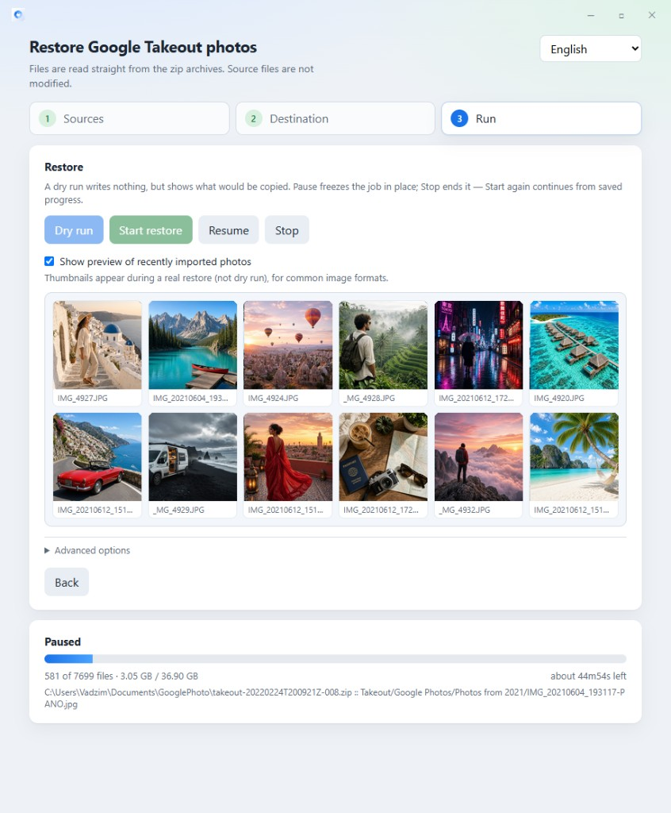

# TakeoutRestore — Fix Google Takeout Photos

**TakeoutRestore** is a free desktop tool that restores **Google Photos Takeout** exports: it fixes wrong dates, writes GPS and descriptions from Google’s JSON sidecars into EXIF, removes album duplicates, and sorts everything into a clean `Year/Month` library — reading `takeout-*.zip` files directly, without extracting them first.

One portable app for Windows, macOS and Linux. No Python. ExifTool is built in.



## Download

Prebuilt binaries are in [`releases/`](releases/).

| Platform | Desktop app | Command line |
|---|---|---|
| Windows x64 | [TakeoutRestore.zip](releases/TakeoutRestore.zip) | [TakeoutRestore-windows-amd64-cli.exe](releases/TakeoutRestore-windows-amd64-cli.exe) |
| Linux x64 | [TakeoutRestore-linux-amd64.tar.gz](releases/TakeoutRestore-linux-amd64.tar.gz) | [TakeoutRestore-linux-amd64-cli](releases/TakeoutRestore-linux-amd64-cli) |
| Linux ARM64 | — | [TakeoutRestore-linux-arm64-cli](releases/TakeoutRestore-linux-arm64-cli) |
| macOS Intel | — | [TakeoutRestore-darwin-amd64-cli](releases/TakeoutRestore-darwin-amd64-cli) |
| macOS Apple silicon | — | [TakeoutRestore-darwin-arm64-cli](releases/TakeoutRestore-darwin-arm64-cli) |

Windows zip unpacks to `TakeoutRestore.exe`. Linux tar.gz unpacks to `./TakeoutRestore` (`chmod +x` if needed). CLI builds also have the `-web` browser UI.

## Quick start

1. Download the desktop app for your OS from the table above and unzip it.
2. Open `TakeoutRestore.exe` (Windows) or `./TakeoutRestore` (Linux).
3. Add the folder with your Google Takeout zips, choose a destination, press **Start restore**.
4. Check the report when it finishes. Pause / Stop freeze or end a run; Start again continues from saved progress.

Windows SmartScreen may warn about an unsigned app: **More info → Run anyway**. WebView2 is required (included with current Windows 10/11). On Linux the desktop window needs WebKitGTK — see the [full guide](docs/USAGE.md#linux).

Command line (optional `-dry-run` writes nothing, only a report):

```
TakeoutRestore.exe -src "D:\Takeout" -dest "D:\Photos Restored" -dry-run
```

## What it fixes in Google Takeout

| Problem after Google Takeout | What TakeoutRestore does |
|---|---|
| Wrong “date taken” (often the export date) | Restores `photoTakenTime` into EXIF / QuickTime |
| GPS & captions stuck in `.json` files | Writes location, description, people, favorites into the media |
| Same photo in albums and `Photos from YYYY` | Keeps one copy; albums via hard links (no extra disk use) |
| Dozens of split `takeout-*.zip` parts | Reads zips in place; matches truncated / `(1)` / `-edited` JSON names |

## Languages

English by default. Switch language in the app (remembered) or with `-lang en|ru|…`. Folder names follow the language for a new destination.

## Docs & license

- **[Full usage guide](docs/USAGE.md)** — CLI options, output layout, date rules, Linux/macOS, building from source, limitations
- [MIT](LICENSE) · Embedded ExifTool: [THIRD_PARTY_LICENSES.md](THIRD_PARTY_LICENSES.md)

---

*Keywords: Google Takeout photos, fix Google Photos Takeout metadata, restore date taken from Takeout JSON, Google Photos export organizer, merge Takeout zip files, Google Takeout EXIF GPS*
